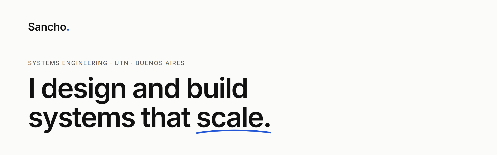

<a href="https://sanchopodesta.ar/en/">
  <picture>
    <source media="(prefers-color-scheme: dark)" srcset="./banner-dark.png">
    
  </picture>
</a>

Software developer at **[Zentor](https://zentor.io)**, where I designed the architecture from scratch. I see technology and business as one thing: understand the problem, design the solution, and know how to tell it.

[sanchopodesta.ar](https://sanchopodesta.ar/en/) · [LinkedIn](https://linkedin.com/in/santiagopodesta) · [CV](https://sanchopodesta.ar/cv-santiago-podesta.pdf) · [santi.podesta.c@gmail.com](mailto:santi.podesta.c@gmail.com)

### Architectures from scratch

**Zentor backend: gateway and products microservice** 
A lightweight gateway that owns auth, accounts and payments, and a products microservice with workers that scale independently. Modular NestJS services, separate databases, and Prisma migrations designed to run without downtime. 
`NestJS` `Prisma` `PostgreSQL` `Docker`

**Public API and official MCP** 
Reworked authentication so any consumer is just another client of the same API, with an OpenAPI contract as the single source of truth. The official MCP, listed in the Claude directory, is simply one more client. 
`OpenAPI` `MCP` [`docs.zentor.io`](https://docs.zentor.io)

**Data automation for marketing** · Winclap 
Cloud Run pipelines that consolidate sources into BigQuery, with Apps Script as the entry layer for end users. 
`Python` `BigQuery` `Cloud Run` `Apps Script`

### Skills

**Backend** · NestJS · TypeScript · Node.js · Prisma · PostgreSQL / MySQL · Docker · Render 
**Languages & data** · Python · BigQuery · JavaScript · Java · PHP · C++ / C# · Assembler · Arduino

### Education

Systems Engineering · UTN, 4th year · Advanced Full Stack Developer · ITBA · English C1

Most of my work lives in Zentor's private repos. The code for my portfolio is in <a href="https://github.com/Sancho6446/mi-portfolio">mi-portfolio</a>.
